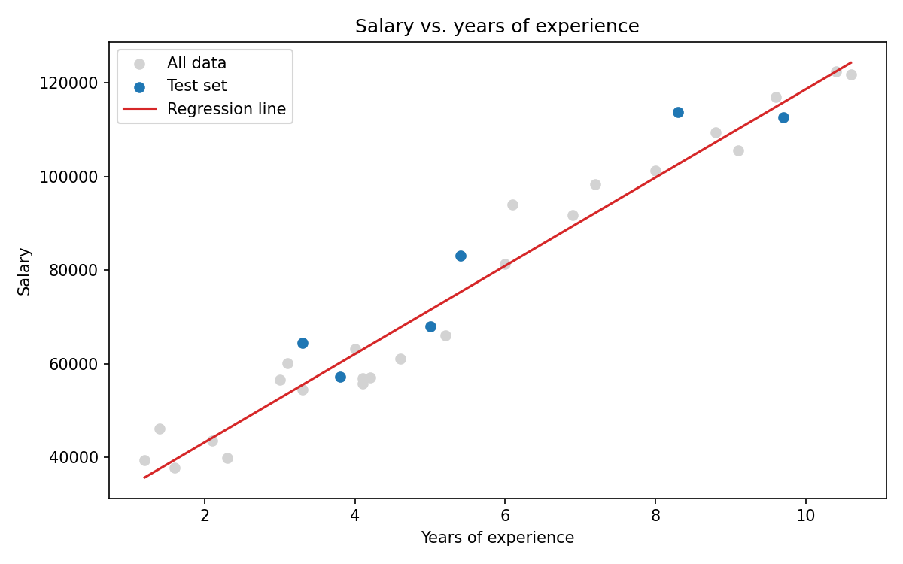

# Salary Prediction – Simple Linear Regression

Predicts an employee's salary from their years of experience using scikit-learn's `LinearRegression`.



## Dataset

`data/Salary_dataset.csv` – 30 rows, two useful columns:

| Column            | Description                 |
|-------------------|-----------------------------|
| `YearsExperience` | Years of work experience    |
| `Salary`          | Annual salary               |

(The file also contains an unnamed index column, which the script drops on load.)

## Project structure

```
regression/
├── data/
│   └── Salary_dataset.csv
├── images/
│   └── regression_plot.png
├── src/
│   └── model.py
├── requirements.txt
└── README.md
```

## Getting started

```bash
git clone https://github.com/isof0001/regression.git
cd regression

python -m venv .venv
source .venv/bin/activate        # Windows: .venv\Scripts\activate
pip install -r requirements.txt

python src/model.py
```

### Options

| Flag             | Default | Description                              |
|------------------|---------|------------------------------------------|
| `--data`         | `data/Salary_dataset.csv` | Path to the CSV file   |
| `--output-dir`   | `images/` | Where the plot is saved                |
| `--test-size`    | `0.2`   | Fraction of data held out for testing    |
| `--seed`         | `42`    | Random seed for the train/test split     |
| `--show`         | off     | Open the plot in a window                |

## Method

1. Load the CSV and drop the unnamed index column.
2. Split into 80% train / 20% test (`random_state=42`).
3. Fit `LinearRegression` on the training set.
4. Evaluate on the test set with RMSE, MAE and R².
5. Save a plot of the data and fitted line.

## Results

With the default settings:

| Metric | Value |
|--------|-------|
| RMSE   | ≈ 7,059 |
| MAE    | ≈ 6,286 |
| R²     | ≈ 0.90 |

Fitted model: `Salary ≈ 24,380 + 9,424 × YearsExperience`
(each extra year of experience adds roughly 9.4k to the predicted salary).

> **Note:** the test set only has 6 samples, so these metrics are noisy. Cross-validation would give a more reliable estimate.

## Ideas for next steps

- Add k-fold cross-validation
- Compare with polynomial regression or other models
- Add residual plots to check model assumptions
